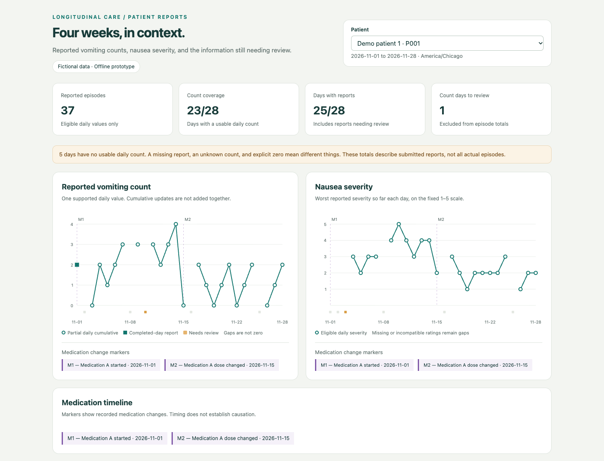

# Patient-Reported Data: Store, Manage & Chart

A Track B prototype for fictional nausea/vomiting reports: extract source claims,
validate them, preserve history in SQLite, apply counting/correction rules, and
show patient trends with coverage and unresolved values. All deliverables are in
English. No real patient information is used.

A separate [five-report text pilot](data/text_pilot/README.md) now contains actual
LLM-generated feedback, reviewed references, and generation provenance. It is a
data-preparation step: extraction evaluation has not yet run, and the existing
offline dashboard below still uses its original mixed-input dataset.

## Run the complete offline demo

Use Python 3.11 or newer; tested with Python 3.14.

```bash
python3 -m venv .venv
source .venv/bin/activate
python -m pip install -r requirements.txt
python -m unittest discover -s tests -q
python run_demo.py build --output artifacts/demo
```

Open **`artifacts/demo/dashboard.html`** in a browser. No server, API key, or
internet connection is needed after dependency installation. Use a new output
directory for another build; existing runs are never overwritten.

The demo has **71 reports, three patients, and 28 follow-up days per patient**.
It reuses ten actual saved LLM candidate batches and directly processes 61
questionnaire-only reports. It does not use gold to fabricate predictions and
does not make new model requests. Both the database and dashboard preserve the
known limitations of the recorded extraction. See the
[demo walkthrough](docs/demo_walkthrough.md) for a presentation sequence.



A selected [generated example](results/longitudinal-demo/dashboard.html), query
exports, and [validation record](docs/prototype_validation.md) are also saved
for review. Download the HTML file to open that snapshot locally; GitHub's file
viewer does not execute the dashboard.

Generated files include `patient_reports.sqlite`, `predictions.jsonl`,
`daily.csv`, `weekly_counts.csv`, `after_medication_change.csv`,
`review_queue.csv`, `summary.json`, and the standalone dashboard.

```bash
python run_demo.py query --db artifacts/demo/patient_reports.sqlite --query weekly
python run_demo.py query --db artifacts/demo/patient_reports.sqlite --query medication
python run_demo.py query --db artifacts/demo/patient_reports.sqlite --query review
```

Queries open the database read-only. Weekly counts include reporting coverage;
missing values do not become zeros. The medication query compares symptoms with
recorded starts, stops, or dose changes, not each day's actual medication intake.
It remains available through SQL, the CLI, and CSV exports; the dashboard uses
labeled medication markers rather than a separate timing-comparison table.

## What is implemented

| Component | Behavior |
| --- | --- |
| Data contract | Strict v0.2 schemas for source reports, candidates, normalized observations, and references. |
| Text extraction | OpenAI Responses API and optional Ollama adapter, with source-only model input and explicit provenance. |
| Normalization | Relative dates, literal evidence checks, clock-boundary checks, severity eligibility, and compatible text/form reconciliation. |
| SQLite | Immutable source IDs and extraction runs; failed results, evidence, and correction history retained. |
| Daily statistics | Complete replacements, cumulative no-sum rules, explicit zeros, missing days, field-specific eligibility, and review reasons. |
| SQL | Weekly reported counts with coverage; symptoms relative to recorded medication changes. |
| Dashboard | Patient selection, count/severity trends, labeled medication changes, weekly coverage, concrete review explanations, and expandable source records. |
| Validation | Offline tests for schemas, clients, time boundaries, corrections, aggregation, database integrity, queries, and integration. |

R006 corrects R005's vomiting count from 3 to 2 while retaining nausea severity 4.
The original remains in the database, and the trend uses 2. The three cumulative
records are not summed into 7. Unknown/conflicting counts and unresolved event
overlap stay out of daily totals and remain reviewable.

## Extraction experiments and model configuration

The provisional cloud model is `gpt-5.4-mini-2026-03-17`. V1 remains the default
prompt; v2 and v3 remain experimental because their measured improvements came
with material regressions. No fine-tuning was performed. Historical experimental
outputs are preserved unchanged; their frozen runtime is available in Git.

| Evidence | Purpose |
| --- | --- |
| [First development run](docs/development_run.md) | Ten original reports and the first actual model outputs. |
| [Temporal comparison](docs/prompt_comparison.md) | 140 paired calls comparing v1/v2. |
| [Scope/evidence comparison](docs/prompt_v3_comparison.md) | 280 paired calls on 50 known and 20 fresh cases, v1/v3. |
| [First normalization fix](docs/normalization_fix.md) | Offline replay of the midnight-to-submission reconciliation correction. |
| [Time-boundary fixes](docs/time_boundaries.md) | Current range variants and rejection of cutoff/interval clocks as episode times. |

For optional fresh cloud extraction, configure `.env` locally with
`OPENAI_API_KEY` and `OPENAI_MODEL`; `.env.example` has the accepted keys. Never
commit a key. Environment values take precedence over `.env`. No shell code or
variable expansion is executed by the loader.

```bash
python run_pipeline.py extract --provider openai \
  --model gpt-5.4-mini-2026-03-17 \
  --output data/processed/new-text-run.jsonl

python run_pipeline.py evaluate \
  --predictions data/processed/new-text-run.jsonl \
  --output artifacts/new-text-run.metrics.json
```

Extraction makes API requests; evaluation does not. It sends only source text,
not questionnaires, metadata, or gold. Requests use strict output, reasoning
effort `none`, a 2,048 output-token cap, and `store=false`; this flag alone is not
a zero-retention guarantee. Errors remain explicit and there are no automatic
retries. Choose a new output path each time. If using `--limit`, evaluation still
includes all supplied reference reports, so unrequested reports count as missing.

The optional local adapter requires an explicitly selected installed model:

```bash
python run_pipeline.py extract --provider ollama --model YOUR_INSTALLED_MODEL \
  --output data/processed/local-run.jsonl
```

See [model selection](docs/model_selection.md) for the selection rationale and
limitations. Installation alone is not evidence of task suitability.

## Files to read

| Location | Purpose |
| --- | --- |
| `docs/design.md`, `docs/storage_and_trends.md` | Field meanings, schema, responsibilities, and counting rules. |
| `docs/demo_walkthrough.md` | Setup, live walkthrough, query commands, and trade-offs. |
| `data/longitudinal/` | Four-week sources, patients, medication changes, and generation notes. |
| `data/raw/`, `data/gold/`, `data/dev/`, `data/heldout/`, `data/heldout_v3/` | Separate extraction-development and validation sources/references. |
| `src/normalization.py`, `src/aggregation.py` | Code-owned time, reconciliation, correction, and eligibility rules. |
| `src/store.py`, `sql/` | SQLite storage and executable queries. |
| `src/demo.py`, `src/dashboard.py`, `web/dashboard.html` | Stored-data demo build and offline chart renderer. |
| `docs/evaluation.md`, `results/` | Metric definitions and selected immutable experimental artifacts. |
| `tests/` | Offline behavioral tests with mocked clients and temporary databases. |

The [dataset guide](data/README.md) distinguishes longitudinal sources from the
70 diagnostic reports and explains overlap. Routine databases/exports are ignored
under `artifacts/`; selected review artifacts are versioned under `results/`.

## Practical limits

This is a local synthetic-data prototype, without authentication, clinical
validation, or a manual review/write-back workflow. Event/window overlap is not
automatically resolved, and unsupported interpretations stay visible for review.
The model can still make semantic errors that pass structural checks. A passing
code test or a completed extraction is not a claim of correct clinical data.
Further prompt work should isolate changes and use new independent cases when
making generalization claims, rather than silently retuning on reviewed outputs.
