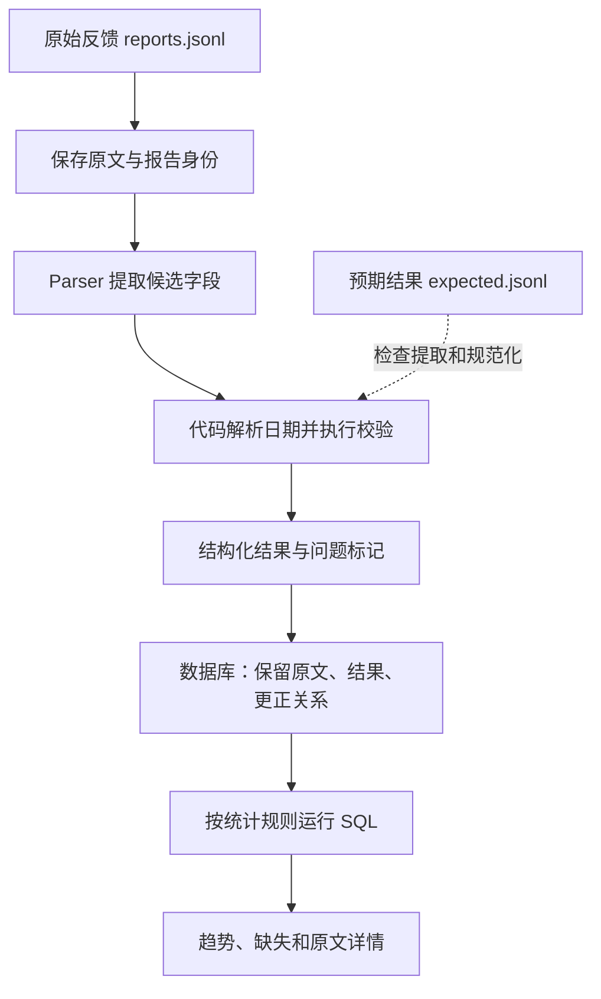

# Track B：患者反馈数据原型设计（v0.1）

这份文档先定义数据含义，再指导数据、解析器、数据库和图表的实现。所有患者、反馈和药物均为虚构。英文作为模拟输入，中文用于解释设计。

当前阶段交付：本设计、10 条原始反馈、对应的预期结果。样例和答案由助手依据本设计逐条起草、核对，供你继续复核，尚未经过独立人工标注。尚未实现解析器、数据库或图表。这 10 条用于讨论和开发，不是独立保留测试集。

## 1. 范围与目标

- 场景：肿瘤科治疗期间，患者报告恶心（`nausea`）和呕吐（`vomiting`）。
- 完整原型计划：3 位虚构患者、连续 4 周；本次只有 10 条设计样例，不代表完整随访。
- 目标：保存原话，把能确定的信息结构化，让医生查看报告趋势、缺失和原文依据。
- `Medication A` 是虚构药物标签，不对应真实药理、剂量或治疗建议。
- 第一版只处理本文明确规定的表达和统计范围；未能可靠解释的信息保留为未知，并标记原因。

## 2. 数据流程与三种数据

| 数据 | 位置 | 作用 |
| --- | --- | --- |
| 原始反馈 | `data/raw/reports.jsonl` | 程序可以读取的输入；保留患者实际提供的信息 |
| 预期结果（gold） | `data/gold/expected.jsonl` | 按本文规则逐条制定的参考答案；仅供验证，不传给解析器 |
| 程序转换结果（processed） | 后续生成 | 解析器实际运行的输出；不能直接复制 gold 冒充提取结果 |

JSONL 表示一行一个 JSON 对象。两个现有文件各有 10 行，通过 `report_id` 对应。

## 3. 先分清“报告”和“症状观察”

- 一条 **报告 report** 是患者的一次提交。
- 一条 **症状观察 observation** 是报告对某个症状、某个时间范围所作的一项描述。
- 一条报告可以产生多条观察。例如，昨天呕吐、今天恶心，应拆成两条。
- 一条观察不一定是一次真实发作；它也可能是累计次数、明确没有症状、担忧未来发生，或者互相冲突的说法。
- 只为文字或问卷实际提到的症状建立观察。没有提到呕吐，不自动补一条“呕吐为零”。

## 4. 原始反馈字段

| 字段 | 类型／示例 | 意思与设计原因 |
| --- | --- | --- |
| `report_id` | 字符串，如 `R001` | 一次提交的唯一编号。连接原文与结果，也便于防止重复导入。 |
| `patient_id` | 字符串，如 `P001` | 虚构患者编号。多条报告可以属于同一患者；当前不需要姓名等资料。 |
| `reported_at` | 带 UTC 偏移的时间，如 `2026-11-02T20:00:00-06:00` | 系统接收反馈的时间。它不是症状发生时间。偏移量明确该时刻。 |
| `patient_timezone` | IANA 时区名，如 `America/Chicago` | 解释“今天／昨天”的日历时区；固定偏移本身不能表达夏令时规则。 |
| `text` | 英文字符串 | 患者原话，保留不改写。后面每个提取结果都应能回查依据。 |
| `questionnaire` | 对象或 `null` | 同次提交的结构化问卷答案。与文字分开保留，才能发现冲突；`null` 表示没有这份问卷。 |
| `supersedes_report_id` | 报告编号或 `null` | 本次是否明确更正某条旧报告。由模拟的“更正”操作提供，不让模型猜旧报告编号。 |

`questionnaire` 非空时包含：

| 子字段 | 意思与设计原因 |
| --- | --- |
| `symptom` | 这份问卷针对哪个症状，避免把恶心的评分套给呕吐。第一版一份问卷对应一个症状。 |
| `event_date` | 问卷明确询问的日期。用于判断文字和问卷是否谈的是同一天。 |
| `count` | 截至本次提交，问卷目标日期内的累计呕吐次数；非负整数或 `null`。`0` 是明确报告零次，`null` 是未提供。当前恶心不收集次数。 |
| `severity` | 针对该症状、该日期的患者自评：1—5 的整数或 `null`。 |

严重程度采用本原型自定义的 1—5 量表，1 表示很轻，5 表示很重。它不是临床评级。缺失用 `null`，不用 0；也不把“吐两次”或“很难受”自动换算成评分。

## 5. 预期结果字段

每行外层结构是 `report_id` 和 `observations`。前者连接对应原始报告；后者是这条报告产生的症状观察列表。本次 10 条报告对应 13 条观察。

这些答案描述的是“提取＋日期规范化＋字段校验”后的预期结果，不要求全部工作都由 LLM 完成。

| 观察字段 | 意思 | 为什么这样设计 |
| --- | --- | --- |
| `observation_id` | 稳定编号，如 `R001-O1` | 同一报告可能有多条观察，需要分别引用。由程序生成，不能依赖模型随机取名。 |
| `symptom` | `nausea` 或 `vomiting` | 用统一名称查询，不受原话中 `vomited`、`threw up` 等词语差异影响。 |
| `assertion` | `present`、`absent`、`hypothetical`、`uncertain` | 分别表示明确发生、明确没有、仅担忧／假设、无法确定。防止把“担心会吐”当作已经吐了。 |
| `count` | 呕吐次数：非负整数或 `null` | 保存明确次数；未知不能填零。当前恶心的次数留空。 |
| `count_scope` | `event`、`window`、`day_to_date` 或 `null` | 次数属于一次具体发作、一个描述的时间段、还是截至上报时的当天累计。范围不同，不能直接相加。 |
| `severity` | 1—5 的自评整数或 `null` | 与次数、症状是否存在分别处理；必须有明确评分依据。 |
| `event_date` | 患者当地日期 `YYYY-MM-DD` 或 `null` | 用于按日／周归属。只有日期可确定时才填写。 |
| `event_time` | 患者当地钟点 `HH:MM` 或 `null` | 仅保留明确钟点；不把“饭后”变成固定时刻。日期和时区仍来自关联字段。 |
| `time_text` | 原话里的时间表达或 `null` | 保存“after dinner”“this morning”等不能被一个日期充分表达的信息。 |
| `date_basis` | `relative_text`、`explicit_text`、`questionnaire`、`unknown` | 分别表示日期由相对表达推算、原文明示、问卷给出，或未知。让日期来源可解释。 |
| `medication_relation` | 用药关联对象或 `null` | 保留患者明确提到的药物关系，不从背景治疗信息推断因果。 |
| `evidence` | 原始依据列表 | 保留支持该观察的原文片段或问卷值，便于核对。 |
| `issues` | 问题标记列表；无问题时 `[]` | 明确为什么某个统计不能进行；不用模型自报的置信分数代替依据。 |

`count_scope` 的例子：

- `event`：今天 14:20 吐了一次，只明确这一次发作。
- `window`：昨晚饭后吐了两次，次数属于描述的时间段；不自动视为全天总数。
- `day_to_date`：今天截至上报时一共吐了两次。即使晚上上报，也不代表之后不会再发生。
- `null`：没有可适用或可确定的计数范围。例如，只有“今天恶心”。次数未知但范围明确时仍可使用 `day_to_date`，见 R008。

`medication_relation` 当前只有两个子字段：`medication` 是原文中的药物标签；`relation` 当前使用 `after_taking`，表示患者描述症状发生在服药后。它表示时间关系，不证明药物导致症状。

`evidence` 每项有 `path` 和 `value`：`path` 指向输入字段，例如 `text` 或 `questionnaire.count`；`value` 保留原文字串或问卷原值。正文证据必须是原话的连续片段。问卷证据必须与输入值一致。

本次 `issues` 使用以下标记：

| 标记 | 意思 |
| --- | --- |
| `date_unknown` | 无法把记录可靠归入某个日期。 |
| `count_unknown` | 知道发生过，但无法确定次数。 |
| `conflicting_sources` | 文字与问卷对同一症状、同一时间范围给出冲突答案。 |

正常未提供严重程度时保留 `null` 即可，不把每一个空字段都标成错误。

## 6. 关键处理规则

### 时间

1. 先将 `reported_at` 对应的时刻转换为 `patient_timezone` 的当地日期，再解释“今天／昨天”。日期运算由代码完成。
2. 只知道日期时，`event_time` 保持 `null`；不能补 `00:00`。
3. 当前输入是开放式反馈，没有“本表单只问今天”的隐含约定。因此“after dinner”本身不能确定日期。
4. 文字和问卷只有在明确描述同一事件／统计范围时才直接比较。分别描述不同日期的情况应拆成不同观察；若明确是同一事件却给出不相容日期，保留两边证据并标记，不任意选一边。
5. 日期未知的记录仍保存和展示，但不强行放进某天的次数趋势。

### 否定、缺失与假设

- “今天没吐”是 `absent`、`count=0`、`count_scope=day_to_date`。
- “今天吐了几次，记不清”是 `present`、`count=null`，并标记 `count_unknown`。
- “担心今晚会吐”是 `hypothetical`，不计入已发生次数；未来担忧的日期仍可以明确。
- 没有提交报告，与明确报告没有症状不同；未提交的日期不能补零。

### 冲突、更正与重复

- 相同症状、日期和计数范围内，文字说 1 次、问卷说 0 次：保留两边证据，`assertion=uncertain`、`count=null`，标记 `conflicting_sources`。
- 若某个字段冲突，只将受影响字段置为未知；仍可确定的日期等信息保留。
- `supersedes_report_id` 是本原型的整条报告更正，要求目标存在、属于同一患者，且更正提交晚于目标；禁止自指和循环。以后如支持只更正部分症状，需要另加更细的规则。
- 旧报告和它的提取结果保留；有效统计排除已被更正的版本。不能把 R005 原本提取出的 3 改写为 2。
- 同一患者、同一症状、同一日期的累计快照不能相加。先处理明确更正，再在有效且范围相同的累计记录中采用最新值。
- 如果累计快照没有明确更正却变小，或不同计数窗口重叠且无法判断，标记待核实；不能简单取最新或取最大值掩盖问题。
- 未来重复导入同一个 `report_id` 不新增副本；若同一 ID 内容改变，应报错或要求明确版本，不能静默覆盖。

### 查询与图表

- 计划查询一：按患者和周统计可确定的已报告呕吐次数，同时展示不能可靠计数的记录和上报覆盖。
- 日累计与其包含的单次发作／时间段记录不能重复相加；范围不明的重叠记录暂不合并。R004—R006 先用于检验最小累计规则。
- 计划查询二：在已知用药变更之后报告了哪些症状。需要独立用药变更表；R010 仅是患者所述服药后症状，不能代替正式变更记录。
- 只有日期而没有钟点时，不能确定症状与同日某次用药变更的先后。
- 图表从数据库查询。次数、评分、缺失和原文详情分开表达。
- 计算覆盖率还需患者随访起止日期；本次未创建该表，因此不计算覆盖率。实际提交日期与症状归属日期也不能混为一谈。

## 7. 10 条样例与预期含义

| 报告 | 原话中文理解 | 预期要点 |
| --- | --- | --- |
| R001 | 昨天晚饭后吐两次；今天整个早上恶心。 | 拆成两条：呕吐归 11 月 1 日、次数 2；恶心归 11 月 2 日、次数未知。 |
| R002 | 今天一直没有吐；今天恶心。问卷恶心评分 3。 | 呕吐明确为 0；恶心评分 3，只作用于恶心。 |
| R003 | 今天 14:20 吐了一次。 | 11 月 3 日 14:20 的一次发作，不代表全天只吐一次。 |
| R004 | 上午：今天截至现在累计吐两次。 | 11 月 4 日的累计快照为 2。 |
| R005 | 晚上：今天截至现在累计吐三次。 | 同一天更新的累计快照为 3；与 R004 不能相加。 |
| R006 | 同日晚间更正 R005：今天截至现在累计吐两次，不是三次。 | 明确更正，发生日期仍是 11 月 4 日；有效累计改为 2。 |
| R007 | 晚饭后吐一次。 | 日期未知、钟点未知；保留“饭后”和次数 1。 |
| R008 | 今天截至现在吐过几次，记不清次数。 | 明确发生、日期明确；次数未知且标记原因。 |
| R009 | 文字说今天累计吐一次；同日问卷填零。 | 来源冲突；发生与否不能统一，次数留空，证据都保留。 |
| R010 | 今天早上服用虚构药物 A 后恶心；担心今晚会吐。 | 恶心确已发生，记录服药后关系；呕吐只是担忧，不能计数。 |

跨记录验收例：仅处理 R004 时累计为 2；加入 R005 后为 3；加入明确更正 R006 后为 2。原始三条记录和各自预期提取结果始终保留。

## 8. 下一步与验证边界

先逐条理解这些样例，再实现结构定义、解析和校验。模型可识别症状、否定和时间表达；普通代码负责编号、日期计算、输入约束和统计规则。

以后把实际转换结果与 gold 对照，分别检查症状、否定／假设、次数、评分、日期和未知值。格式合法不等于语义正确。若发现 gold 有问题，也应按明确规则修订并记录原因；gold 不是不可质疑的医学事实。

这 10 条已用于设计与开发，不报告为独立测试准确率。完整原型还需要额外未参与调规则的测试样例、多周数据、用药变更表、两个 SQL 查询和可运行图表。
