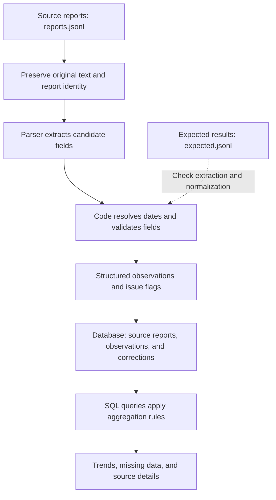

# Track B: Patient-Reported Data Prototype Design (v0.1)

This document defines the meaning of the data before implementation of the parser, database, and charts. All patients, reports, and medication labels are fictional. All submission artifacts, including documentation, sample text, code comments, prompts, and interface labels, must be in English.

The current milestone contains this design, 10 source reports, and their expected structured results. The examples and expected results were drafted with AI assistance and checked against these rules. They have not been independently annotated by a human reviewer. No parser, database, or chart has been implemented. These are development examples, not a held-out evaluation set.

## 1. Scope and goal

- Scenario: patients report nausea (`nausea`) and vomiting (`vomiting`) during oncology treatment.
- Planned full prototype: three fictional patients over four consecutive weeks. The current 10 examples illustrate design decisions and do not constitute the full follow-up dataset.
- Goal: preserve the original reports, structure information that can be supported, and let a provider inspect reported trends, missing information, and source evidence.
- `Medication A` is a fictional label. It does not represent a real drug, dosage, or treatment recommendation.
- The first implementation will cover the expressions and aggregation rules defined here. Information that cannot be interpreted reliably will remain unknown, with an explanation where needed.

## 2. Planned data flow and dataset roles

The diagram describes the intended pipeline, not functionality that already exists.

| Dataset | Location | Purpose |
| --- | --- | --- |
| Source reports | `data/raw/reports.jsonl` | Input available to the pipeline; preserves the information the patient actually supplied. |
| Expected results (gold) | `data/gold/expected.jsonl` | Reference answers authored according to this design. Used for validation, never provided to the parser as input. |
| Processed results | To be generated during implementation | Actual pipeline outputs. Copying the gold file does not demonstrate successful extraction. |

JSONL contains one JSON object per line. The two existing files each contain 10 records, linked by `report_id`.

## 3. Reports and symptom observations

- A **report** is one patient submission.
- An **observation** describes one symptom within a particular time context in that report.
- One report may produce multiple observations. For example, vomiting yesterday and nausea today should become separate observations.
- An observation is not necessarily a confirmed episode. It may describe a cumulative count, explicit absence, a concern about a future symptom, or conflicting statements.
- Create observations only for symptoms mentioned in the text or questionnaire. A report that does not mention vomiting must not automatically produce a zero-vomiting observation.

## 4. Source report fields

| Field | Type or example | Meaning and rationale |
| --- | --- | --- |
| `report_id` | String, such as `R001` | Unique submission identifier. Links source text to results and supports duplicate-import prevention. |
| `patient_id` | String, such as `P001` | Fictional patient identifier. Groups multiple reports from the same patient without requiring a name or other identifying details. |
| `reported_at` | Timestamp with a UTC offset, such as `2026-11-02T20:00:00-06:00` | Time the system received the report, not the time the symptom occurred. The offset identifies the instant. |
| `patient_timezone` | IANA timezone name, such as `America/Chicago` | Calendar timezone used to interpret expressions such as today and yesterday. A fixed offset alone does not encode daylight-saving rules. |
| `text` | English string | Original patient wording, preserved without rewriting. Extracted information must remain traceable to its source. |
| `questionnaire` | Object or `null` | Structured answers submitted with the text. Keeping them separate allows disagreements to be detected. `null` means no questionnaire was supplied. |
| `supersedes_report_id` | Report identifier or `null` | Identifies an earlier report explicitly corrected by this submission. Supplied by the simulated correction action, rather than inferred by guessing a report ID. |

When `questionnaire` is not `null`, it contains:

| Field | Meaning and rationale |
| --- | --- |
| `symptom` | Symptom targeted by the questionnaire. Prevents a nausea rating from being applied to vomiting. The first version supports one symptom per questionnaire. |
| `event_date` | Date explicitly targeted by the questionnaire. Helps determine whether the text and questionnaire describe the same day. |
| `count` | Cumulative vomiting count for the target date as of this submission: a nonnegative integer or `null`. Zero is an explicit report of no episodes; `null` means no count was provided. The current prototype does not collect nausea counts. |
| `severity` | Patient-reported severity for the target symptom and date: an integer from 1 to 5, or `null`. |

The prototype uses a simple self-report scale: 1 means very mild and 5 means very severe. This is not a clinical grading system. Missing severity is `null`, not zero. Neither an episode count nor an adjective such as "uncomfortable" is automatically converted into a numeric severity rating.

## 5. Expected result fields

Each record contains `report_id` and an `observations` list. The identifier links to the source report, and the list contains the observations derived from that report. The current 10 reports have 13 expected observations.

These answers describe the expected result after extraction, date normalization, and field validation. They do not require every step to be performed by an LLM.

| Observation field | Meaning | Rationale |
| --- | --- | --- |
| `observation_id` | Stable identifier, such as `R001-O1`. | Allows individual observations within a report to be referenced. Generated by code rather than chosen randomly by a model. |
| `symptom` | `nausea` or `vomiting`. | Provides a consistent query vocabulary despite variations such as "vomited" and "threw up" in the source. |
| `assertion` | `present`, `absent`, `hypothetical`, or `uncertain`. | Distinguishes an actual symptom, explicit absence, a concern or hypothetical statement, and an unresolved assertion. Prevents a fear of vomiting from becoming a recorded episode. |
| `count` | Vomiting count: a nonnegative integer or `null`. | Preserves explicit counts. Unknown must not become zero. Nausea counts remain `null` in this version. |
| `count_scope` | `event`, `window`, `day_to_date`, or `null`. | Distinguishes a specific episode, a described time window, and the current day's cumulative count as of submission. Counts with different scopes cannot simply be added. |
| `severity` | Self-reported integer from 1 to 5, or `null`. | Kept separate from episode count and assertion status. Requires an explicit rating in the source. |
| `event_date` | Patient-local date in `YYYY-MM-DD` format, or `null`. | Supports daily and weekly grouping. Populated only when the date can be established. |
| `event_time` | Patient-local clock time in `HH:MM` format, or `null`. | Preserves explicitly stated clock times. "After dinner" must not be assigned an invented time. Date and timezone are retained in their associated fields. |
| `time_text` | Original time expression, or `null`. | Preserves useful context such as "after dinner" or "this morning" that a date alone cannot express. |
| `date_basis` | `relative_text`, `explicit_text`, `questionnaire`, or `unknown`. | Records whether the date was resolved from a relative expression, stated explicitly, supplied by a questionnaire, or could not be established. |
| `medication_relation` | Medication relationship object, or `null`. | Preserves a relationship explicitly reported by the patient without inferring causation from treatment context. |
| `evidence` | List of source references. | Retains supporting text excerpts or questionnaire values for inspection. |
| `issues` | List of issue flags, or `[]` if none apply. | Explains limitations that affect interpretation or aggregation. A model's self-reported confidence is not a substitute for evidence. |

Examples of `count_scope`:

- `event`: "I vomited once today at 14:20." This identifies one episode, not a full-day total.
- `window`: "I vomited twice after dinner yesterday." The count belongs to the described window and is not assumed to cover the entire day.
- `day_to_date`: "I have vomited twice in total so far today." This is a current-day cumulative count up to submission, even if submitted in the evening.
- `null`: No applicable or identifiable counting scope, such as a report of nausea without an episode count. A known scope may still accompany an unknown count, as in R008.

`medication_relation` currently has two fields: `medication` contains the medication label from the source; `relation` uses `after_taking` when the patient describes a symptom after taking it. This is a temporal relationship, not proof that the medication caused the symptom.

Each `evidence` item has `path` and `value`. The path identifies an input field, such as `text` or `questionnaire.count`; the value retains an excerpt or the original questionnaire value. Text evidence must be a contiguous substring of the source. Questionnaire evidence must match the input value.

The current examples use these `issues` flags:

| Flag | Meaning |
| --- | --- |
| `date_unknown` | The observation cannot reliably be assigned to a calendar date. |
| `count_unknown` | The symptom occurred, but the episode count cannot be determined. |
| `conflicting_sources` | Text and questionnaire answers conflict about the same symptom and time scope. |

An omitted severity rating may simply remain `null`. Not every missing field is an error that requires a flag.

## 6. Processing rules to implement

### Time

1. Convert the instant in `reported_at` to `patient_timezone` before interpreting today or yesterday. Code performs the date arithmetic.
2. If only a date is known, keep `event_time` as `null`; do not insert `00:00`.
3. These are open-ended reports without an implicit "today only" form context. The phrase "after dinner" alone therefore does not establish a date.
4. Compare text and questionnaire answers directly only when they refer to the same event or aggregation scope. Descriptions of different dates should become separate observations. If they clearly refer to the same event but give incompatible dates, retain both sources and flag the conflict rather than choosing arbitrarily.
5. Retain and display observations with unknown dates, but do not force them into a particular day's count trend.

### Negation, missing information, and hypothetical statements

- "I have not vomited at all today" produces `absent`, `count=0`, and `count_scope=day_to_date`.
- "I vomited a few times today but cannot remember how many" produces `present`, `count=null`, and `count_unknown`.
- "I am worried I might vomit tonight" produces `hypothetical` and contributes no observed episode count. The date of the future concern can still be known.
- No submission is different from an explicit symptom-free report. Do not fill unreported dates with zero.

### Conflicts, corrections, and duplicates

- If text reports one episode and a questionnaire reports zero for the same symptom, date, and count scope, retain both sources, set `assertion=uncertain` and `count=null`, and add `conflicting_sources`.
- Only unresolved fields become unknown. Keep information that remains supported, such as an agreed date.
- In this prototype, `supersedes_report_id` replaces an entire report. The target must exist, belong to the same patient, and precede the correction. Self-references and cycles are invalid. Correcting only part of a report would require a more detailed policy.
- Retain the old report and its original extraction. Exclude superseded versions from effective aggregates. Do not rewrite R005's original extracted count of 3 as 2.
- Do not add cumulative snapshots for the same patient, symptom, and date. Resolve explicit corrections first, then use the latest valid cumulative value with the same scope.
- A decreasing cumulative count without an explicit correction, or overlapping windows that cannot be reconciled, requires review. Do not hide ambiguity by automatically choosing the latest or largest value.
- Reimporting the same `report_id` must not create another copy. Changed content under an existing ID must raise an error or require an explicit version rather than silently overwrite the source.

### Queries and visualization

- Planned query 1: reported vomiting counts by patient and week, accompanied by reporting coverage and records that cannot be counted reliably.
- Do not add a daily cumulative count to episode or window counts that it already contains. Do not combine ambiguous overlapping windows. R004-R006 will exercise the initial cumulative-count rule.
- Planned query 2: symptoms occurring after a known medication change. This requires a separate medication-change table. R010's patient-reported relationship after taking a medication does not replace a formal change record.
- A date without a clock time may be insufficient to determine whether a symptom occurred before or after a medication change on the same day.
- Charts will use database query results and distinguish counts, severity ratings, missing information, and source details.
- Coverage calculations also require each patient's follow-up start and end dates. That table is not present yet, so coverage is not currently calculated. Submission dates and symptom dates must remain distinct.

## 7. Starter cases and expected interpretation

| Report | Source summary | Expected interpretation |
| --- | --- | --- |
| R001 | Vomited twice after dinner yesterday; nauseous all morning today. | Two observations: vomiting on November 1, count 2; nausea on November 2, count unknown. |
| R002 | No vomiting today; nausea today. Questionnaire nausea severity is 3. | Explicit vomiting count of zero; severity 3 applies only to nausea. |
| R003 | Vomited once today at 14:20. | One episode at 14:20 on November 3, not a full-day total. |
| R004 | Morning submission: two vomiting episodes in total so far today. | Cumulative snapshot of 2 for November 4. |
| R005 | Evening submission: three vomiting episodes in total so far today. | Later cumulative snapshot of 3 for the same day; do not add it to R004. |
| R006 | Later that evening, corrects R005: two episodes in total so far today, not three. | Explicit correction for November 4; the effective cumulative count becomes 2. |
| R007 | Vomited once after dinner. | Date and clock time are unknown; preserve the dinner context and count of 1. |
| R008 | Vomited a few times in total so far today but cannot recall the count. | Occurrence and date are known; count remains unknown with an issue flag. |
| R009 | Text reports one episode so far today; the same-day questionnaire reports zero. | Sources conflict; assertion is unresolved and count remains unknown. Retain both sources. |
| R010 | Nausea after taking fictional Medication A this morning; worried about vomiting tonight. | Nausea occurred, with a reported temporal medication relationship. Vomiting is hypothetical and must not count as an observed episode. |

All dates above are in 2026. Cross-report acceptance example: R004 alone gives a cumulative count of 2; adding R005 updates it to 3; adding the explicit correction R006 changes it to 2. Preserve all three source reports and their individual expected extractions throughout.

## 8. Next steps and validation limits

Review these examples, then implement the data structures, parser, and validators. A model may identify symptoms, negation, and time expressions. Deterministic code will handle identifiers, date arithmetic, input constraints, and aggregation rules.

Compare actual outputs against the gold file by symptom, assertion, count, severity, date, and handling of unknown values. Valid output structure does not prove correct interpretation. If a reference answer is found to be wrong, revise it using an explicit rule and record the reason; it is not an unquestionable clinical fact.

These 10 examples have been used for design and development and cannot support claims of independent test accuracy. The full prototype still needs additional held-out cases, multi-week data, a medication-change table, two SQL queries, and a working chart.
