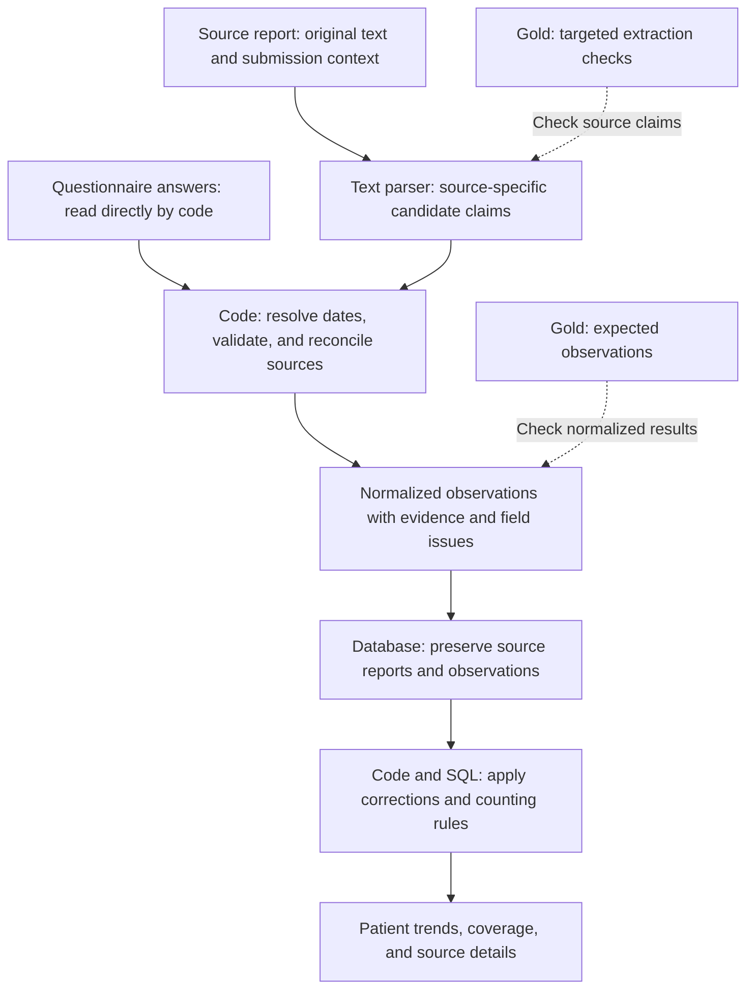

# Track B: Patient-Reported Data Prototype Design (v0.2)

This document defines the data contract for extraction, normalization, and the planned database and charts. All patients, reports, and medication labels are fictional. All submission artifacts, including documentation, sample text, code comments, prompts, and interface labels, must be in English.

Current deliverables include executable schemas, cloud/local extraction adapters, deterministic normalization, evaluation, SQLite storage, correction-aware aggregation, two SQL queries, and an offline dashboard. The longitudinal demo has 71 reports from three fictional patients over 28 days; the separate diagnostic sets contain 70 reports and 83 reference observations. Examples and references are AI-assisted synthetic material, not independently human-annotated clinical ground truth. See [storage and trend rules](storage_and_trends.md), [demo instructions](demo_walkthrough.md), and [dataset roles](../data/README.md). The original ten-report fixtures and historical model outputs remain unchanged.

## 1. Scope and changes in v0.2

The scenario covers nausea (`nausea`) and vomiting (`vomiting`) during oncology treatment. The implemented longitudinal demo covers three patients over four consecutive weeks. The original ten reports remain small extraction examples; the additional follow-up reports are structured questionnaires, not new LLM validation cases. `Medication A` is a fictional label and makes no claim about a real drug, dosage, or treatment.

Version 0.2 makes six changes:

1. Separate text extraction, deterministic normalization, and cross-report aggregation.
2. Add `day_total` for an explicitly reported total over a completed calendar day.
3. Replace the single `questionnaire` object with a `questionnaire_answers` list.
4. Represent issues as `{field, code}` objects, so only the affected fields lose usability.
5. Define severity as the worst symptom severity so far today on a fixed 1-5 scale.
6. Require complete replacement reports for corrections, and keep generated identifiers out of semantic accuracy scoring.

The source fixtures were deliberately revised for this version; their earlier versions remain in Git history. This does not permit an operational pipeline to overwrite a received patient report silently.

## 2. Processing stages and dataset roles

All stages in this diagram are implemented. The offline demo replays saved model candidates for the original text and processes the additional questionnaires directly, then queries the stored data to produce trends.

The original starter fixtures below remain unchanged. Later prompt experiments add 20 development, 20 first held-out, and 20 fresh v3 validation reports, bringing the diagnostic sets to 70 reports and 83 reference observations. Their roles and pre-inference reviews are documented in [data/README.md](../data/README.md); measured gains, regressions, and known code limitations are in [prompt_comparison.md](prompt_comparison.md). The separately documented `data/longitudinal/` dataset supplies four-week follow-up; diagnostic cases are not mixed into its patient trends.

| Dataset | Location | Purpose |
| --- | --- | --- |
| Source reports | `data/raw/reports.jsonl` | Original text, structured questionnaire answers, and submission metadata. |
| Expected results (gold) | `data/gold/expected.jsonl` | Authored reference answers and a few source-specific checks. Never passed to the parser as input. |
| Processed results | `data/processed/`; selected run in `results/gpt54mini-dev-v1/` | Actual outputs of the implemented pipeline. Copying gold is not successful extraction. |

Each existing JSONL file contains 10 records, one JSON object per line. Records are linked by `report_id`.

### Responsibilities

- **Text parser:** reads the original text and identifies source claims, including symptom, assertion, count and scope, quoted time expressions, explicit score and scale, score context, and medication relationships. An LLM is optional. Questionnaire answers are handled directly by code rather than being merged by the model.
- **Normalization code:** resolves relative dates using the report context; enforces the score contract; compares compatible text and questionnaire claims; produces normalized values, evidence, and field-specific issues; and assigns reference identifiers.
- **Aggregation code:** applies valid corrections, prevents cumulative double counting, and computes query-specific eligibility. An observation may be usable for a count trend but unusable for a severity trend.

The parser must preserve conflicting source values before reconciliation. For R009, the text candidate is count 1, while the questionnaire value is 0; only the normalized count becomes `null`. For R002, the text candidate severity is 2/5, the questionnaire rating is 3/5, and only the normalized severity becomes `null`.

The internal candidate object and diagnostic output are not another complete dataset. Targeted checks use candidate field names such as `symptom`, `assertion`, `count`, `count_scope`, `severity_value`, `severity_scale_max`, and `severity_context`. `severity_context=worst_today_so_far` identifies a compatible score; current-only, other, or unknown contexts remain distinguishable before normalization. Preserve the original time expression for code to resolve. Do not ask a model to invent database IDs, final issue flags, correction targets, or aggregate totals.

## 3. Reports and observations

A **report** is one submission. An **observation** is a claim about one symptom within a particular time context. A report may yield multiple observations, including explicit absence or hypothetical symptoms rather than confirmed episodes.

Create observations only for symptoms actually mentioned in text or questionnaire answers. No mention is not explicit absence. Keep descriptions of different dates or incompatible time scopes separate; sharing a symptom and date alone does not prove two descriptions are the same event.

## 4. Source report contract

| Field | Type or example | Meaning and rationale |
| --- | --- | --- |
| `report_id` | String, such as `R001` | Unique submission identifier; links input and output and supports duplicate-import checks. |
| `patient_id` | String, such as `P001` | Fictional patient identifier for longitudinal grouping. |
| `reported_at` | Timestamp with UTC offset, such as `2026-11-02T20:00:00-06:00` | When the submission was received, not when the symptom occurred. |
| `patient_timezone` | IANA name, such as `America/Chicago` | Timezone snapshot used to interpret the patient's relative dates. Retain it even when a patient table is added. |
| `text` | English string | Original wording, preserved for inspection. |
| `questionnaire_answers` | List of answer objects; `[]` if none | Allows a single submission to include answers about multiple symptoms. |
| `supersedes_report_id` | Report ID or `null` | Target of an explicit complete-replacement edit action. Never inferred by the model from a partial correction sentence. |

Each questionnaire answer contains:

| Field | Meaning and rule |
| --- | --- |
| `symptom` | Target symptom: `nausea` or `vomiting`. At most one answer per symptom and date in a report. |
| `event_date` | Date targeted by the form. In v0.2 the form asks about today, so this must equal the patient-local submission date. Historical totals can be supplied in text. |
| `count` | Vomiting episodes from the start of today up to submission: a nonnegative integer or `null`. The implied scope is `day_to_date`. Nausea count remains `null`. |
| `severity` | Integer 1-5 answering the fixed question below, or `null` if no rating is supplied. |

### Fixed severity question

> How severe has your [symptom] been at its worst so far today, on a scale from 1 to 5?

Use 1 = very mild, 2 = mild, 3 = moderate, 4 = severe, and 5 = very severe. This is a prototype self-report scale, not a clinical grading system. If the symptom did not occur, do not enter a severity rating; explicit absence is recorded separately. A missing rating is `null`, not zero.

The normalized `severity` field always has this meaning. A free-text rating is accepted only when it explicitly supplies the same 1-5 scale and the same worst-so-far-today context. A current-only rating, a score out of 10, a historical-day score, or an unclear time basis must not be silently mixed into this trend. Preserve the candidate value and evidence, leave normalized severity unknown, and flag the affected field. No conversion from episode counts, adjectives, or another score scale is permitted.

## 5. Normalized observations and gold records

Each gold record contains:

| Field | Purpose |
| --- | --- |
| `report_id` | Links to the source submission. |
| `extraction_checks` | A small list of source-specific assertions to check before reconciliation; `[]` when no additional check is specified. |
| `observations` | Expected results after date normalization, field validation, and source reconciliation. There are 15 across the 10 reports. |

Each observation contains:

| Field | Meaning and rationale |
| --- | --- |
| `observation_id` | Reference label such as `R001-O1`, assigned by code. See the identifier policy below. |
| `symptom` | `nausea` or `vomiting`, independent of the source wording. |
| `assertion` | `present`, `absent`, `hypothetical`, or `uncertain`. Distinguishes occurrence, explicit absence, a concern or hypothetical statement, and unresolved presence. |
| `count` | Supported vomiting count: nonnegative integer or `null`. Nausea counts remain `null` in this version. |
| `count_scope` | `event`, `window`, `day_to_date`, `day_total`, or `null`; determines how a count may be interpreted and aggregated. |
| `severity` | Supported 1-5 worst-so-far-today rating under the fixed contract, or `null`. Independent of episode count. |
| `event_date` | Patient-local date, `YYYY-MM-DD`, or `null`. Do not force a multi-day count into a single date. |
| `event_time` | Exact patient-local episode time, `HH:MM`, or `null`. A range endpoint or cumulative cutoff is not an episode time; retain it in `time_text`. Never invent a time for meals or parts of a day. |
| `time_text` | Original time expression, or `null`, preserving context not represented by the date alone. |
| `date_basis` | `relative_text`, `explicit_text`, `questionnaire`, or `unknown`; records how the single date was established. |
| `medication_relation` | Object or `null`, preserving an explicitly reported temporal relationship without asserting causation. |
| `evidence` | List of `{path, value}` source references. |
| `issues` | List of `{field, code}` objects; `[]` when no issue applies. Each item names the affected observation field. |

### Count scopes

| Scope | Example | Interpretation |
| --- | --- | --- |
| `event` | "I vomited once today at 14:20." | A particular episode, not an entire day's total. A precise clock time is not required for an episode to exist. |
| `window` | "I vomited twice after dinner yesterday." | Count over a described interval. Its boundaries or overlap with other records may be unresolved. |
| `day_to_date` | "I have vomited three times in total so far today." | Current-day cumulative count up to submission. An evening report is still not automatically a complete-day total. |
| `day_total` | "I vomited twice in total yesterday." | Explicit total for a completed calendar day; its date must precede the local submission date. |
| `null` | Nausea without an episode count. | No applicable or identifiable counting scope. An unknown count may still have a known scope, as in R008. |

For annotation consistency, a count framed around a meal or another described interval is labeled `window`, even when the count is one, as in R007. Use `event` when the text identifies a particular episode, as in R003. This convention distinguishes the intended count scope without claiming that an exact clock time is required for an episode.

A count over several days remains a `window` count with its source text preserved. In this limited single-date representation, set `event_date=null`, `date_basis=unknown`, and flag the unsupported time range. Do not split the count across days or assign it to the submission date. "I vomited again" also does not prove that a new record is independent of earlier counts; unresolved relationships must not be summed automatically.

### Evidence and medication relationships

Evidence paths use dot notation with zero-based list indexes, such as `questionnaire_answers.0.severity`. `value` is an exact questionnaire value or a contiguous source-text substring. Preserve evidence from both sides of a conflict. A valid substring is necessary for traceability but does not alone prove correct interpretation.

`medication_relation` contains `medication` (the source label) and `relation`. The current relation `after_taking` means the patient described a symptom after taking the medication. It does not establish causation and is not a medication-change record.

### Field-specific issues

| Field | Code | Meaning |
| --- | --- | --- |
| `event_date` | `date_unknown` | No reliable single date can be established. |
| `event_date` | `unsupported_time_range` | The claim spans several dates and cannot be placed in a single-day trend. |
| `count` | `count_unknown` | Occurrence is reported, but no exact count is known. |
| Any affected observation field | `conflicting_sources` | Compatible source claims disagree on that field. |
| `severity` | `unsupported_scale` | A rating uses a different or unspecified numeric scale. |
| `severity` | `unsupported_severity_context` | A rating targets a different context, such as current severity or a historical day. |
| `severity` | `severity_context_unknown` | The rating's time or summary context cannot be established. |
| `count` | `unresolved_count_relationship` | A count cannot be safely combined with other records because independence or overlap is unresolved. |

Not every `null` requires a flag: an unmentioned severity rating can simply remain unknown. Issues should identify the reason, not duplicate multiple equivalent flags. Cross-report overlap and correction diagnostics are determined by aggregation or input-validation code, not guessed by the text model.

For example, R002 has `assertion=present` for nausea, but `severity=null` and `{"field":"severity","code":"conflicting_sources"}`. R009 has separate issues for `assertion` and `count`, because zero and one disagree on both presence and number. If both sources instead report positive but different counts, presence remains `present` and only count is unresolved.

## 6. Time, corrections, and counting rules

### Date normalization and source reconciliation

1. Interpret relative expressions against `reported_at` converted to `patient_timezone`. Code performs calendar arithmetic.
2. If only a date is known, keep the clock time unknown; do not substitute midnight. Approximate times must not be promoted to exact clock times.
3. Free text is open-ended. The questionnaire's today-only context does not make an undated text statement refer to today.
4. Compare claims only when symptom, date, and relevant scope are compatible. Different dates or event versus daily scopes may require separate observations rather than a conflict.
5. Unknown dates and unsupported ranges are retained for inspection but excluded from single-day allocation.
6. Resolve only fields supported by the sources. A conflict in severity must not invalidate a consistent count or date.

When compatible daily claims contain a text score rejected for its scale or context and an independently valid questionnaire score, the normalized severity may use the questionnaire value. Retain the rejected text score's evidence and issue as source diagnostics; this is not a score conversion. Only disagreements between eligible severity values create a severity conflict. An unsupported-score issue therefore does not, by itself, exclude an independently supported non-null severity from a future trend. Exact events, narrower windows, and earlier within-day cumulative snapshots remain separate from a submission-time daily answer.

For nausea, an explicit cumulative occurrence phrase such as `today up to now`
can join a compatible daily-worst score within the same report. `Right now`,
morning-only claims, different dates, explicit event clocks, and medication
contexts remain separate. Grouping preserves original candidates and unions
their evidence. Conflicting eligible daily ratings produce an unresolved null
severity with `conflicting_sources`, never a selected score. Current-only scores
remain in candidates/evidence and do not become daily-worst severity. See the
[separate Python and prompt validation](../results/text-validation-nausea/README.md).

### Complete report replacement

`supersedes_report_id` is supplied by an explicit edit operation that submits the entire revised text and questionnaire payload. The replacement must repeat information that remains valid. In the current fixtures, R006 changes R005's vomiting count from 3 to 2 and explicitly repeats nausea severity 4.

Validate that the target exists, belongs to the same patient, and precedes the replacement; reject self-references and cycles. A partial message such as "change vomiting to two" must not automatically replace a multi-symptom report. Preserve it for review and do not apply it as a complete correction or count it as an independent new episode. Completeness is an input contract: an ID alone cannot prove the author intended a full replacement. The MVP does not support implicit deletion of another symptom or partial field updates; omissions require review.

Keep the original report and its original normalized observations. Compute which version is effective when aggregating. Do not rewrite R005's original count of 3 or erase its nausea observation. An invalid or incomplete correction must not deactivate the valid target.

Reimporting an unchanged `report_id` must not create a duplicate. Changed contents under the same ID require an explicit new version or an error, not silent overwriting.

### Aggregation boundaries

- An explicit absence over a known scope may contribute zero. Missing reports, unknown counts, and hypothetical symptoms must not be converted to zero.
- Resolve valid replacements first. For compatible same-day cumulative snapshots, use the latest supported value without summing snapshots. A later unknown/conflicting claim blocks fallback to an earlier known value. A decrease without an explicit correction, or known occurrence contradicted by later daily absence, requires review.
- A compatible `day_total` replaces earlier partial-day snapshots for that date in the total calculation; it is not added to them. If it contradicts a larger earlier count without an explicit correction, flag the inconsistency for review rather than choosing silently.
- Do not add episode or window counts already covered by a cumulative count. Combine separate episodes or windows only when their non-overlap is supported; unresolved relationships stay out of the combined count and remain visible.
- Clearly label partial reported counts and complete-day totals. "Reported count" is not proof that every real episode was captured.
- Compute query-specific eligibility, correction status, and review indicators from the rules and evidence. Do not store redundant `is_valid`, `is_active`, and `needs_review` booleans that can disagree.

## 7. Identifiers and layered validation

Gold `observation_id` values are reference labels, not medical identities and not fields an LLM must generate. For display, order observations by known date first, then known clock time, symptom, count scope, and assertion; use a canonical serialization of the remaining content to break ties. The current fixtures follow this ordering. Labels may change when source content or the schema changes; they are not guaranteed stable across reparsing versions.

SQLite stores observation identifiers under a processing run and report; their composite identity preserves processing versions. Semantic evaluation matches observations by symptom, time, and source evidence, not by output-array position or a database ID. Different valid evidence excerpts should not automatically fail an otherwise correct extraction.

Each targeted extraction check contains `source` (a `{path, value}` reference) and `expected_fields` (only the candidate fields being checked). Current checks cover R001's complete-day count, R002's text rating of 2/5, and R009's text count of 1. These checks are evaluated before questionnaire reconciliation; then compare normalized observations to gold. No additional full candidate dataset is required.

Format validation and semantic evaluation are separate. Run diagnostics distinguish parse failures from a successful extraction with no relevant symptoms; a model error must not become a symptom-free report. Reference answers can be revised with a documented reason and are not independent clinical ground truth. [evaluation.md](evaluation.md) defines implemented matching and denominators.

## 8. Starter examples and acceptance expectations

| Report | Case | Expected result |
| --- | --- | --- |
| R001 | Yesterday's complete-day vomiting total and today's morning nausea. | Vomiting count 2 with `day_total` on November 1; separate nausea on November 2. |
| R002 | Text gives worst-so-far-today nausea severity 2/5; questionnaire gives 3/5. Both sources report no vomiting. | Only nausea severity is unresolved. Vomiting remains absent with count 0. Two questionnaire entries are preserved. |
| R003 | One vomiting episode today at 14:20. | One event at 14:20 on November 3, not a full-day total. |
| R004 | Morning cumulative vomiting count of 2. | `day_to_date` count 2 for November 4. |
| R005 | Evening cumulative vomiting count of 3 and worst-so-far-today nausea severity 4/5. | Two observations, both preserved as the original version. |
| R006 | Complete replacement of R005: vomiting count 2, with nausea severity 4/5 repeated. | Effective vomiting count becomes 2; nausea severity remains 4. Original R005 observations remain stored. |
| R007 | Vomited once after dinner without a date. | Count 1 and dinner context retained; unknown date flagged. |
| R008 | Vomited a few times today but cannot recall the count. | Presence and date known, count unknown with a field-specific issue. |
| R009 | Text count 1; same-day questionnaire count 0. | Text extraction check expects 1. Normalized assertion and count are unresolved, with two field-specific issues. |
| R010 | Nausea after fictional Medication A this morning; worried about vomiting tonight. | Reported temporal medication relationship for nausea; vomiting is hypothetical and contributes no observed count. |

All dates are in 2026. Across R004, R005, and R006, effective cumulative vomiting counts progress 2 -> 3 -> 2; they are never summed. Nausea severity from the corrected report is retained at 4.

Additional model-evaluation examples are needed before claiming broader coverage: multi-day counts, ambiguous incremental reports, incompatible severity scales or contexts, incomplete corrections, and decreasing cumulative counts without a correction. Offline tests cover several normalization boundaries, but these are not held-out model outputs. Cross-report correction and aggregation behavior is implemented with targeted boundary tests and conservative exclusion of unresolved counts.

## 9. Implemented downstream inputs and remaining limits

`data/longitudinal/patients.json` defines follow-up and timezone metadata;
`medication_changes.json` defines five fictional timestamped changes. SQLite
preserves these separately from symptom observations. The weekly query includes
coverage, partial counts, and review indicators. The medication query classifies
known and indeterminate temporal order without asserting causation.

`src/aggregation.py` applies complete corrections, avoids cumulative double
counting, and derives per-field eligibility. Date-changing or symptom-removing
corrections remain outside the supported conservative replacement contract;
they require review and do not deactivate the original. A manual review/write-back
workflow and general event/window overlap resolution are not implemented.

The local HTML dashboard displays stored query results, gaps, explicit zeros,
severity, medication markers, and source evidence. See [storage_and_trends.md](storage_and_trends.md)
for the implemented rules and [time_boundaries.md](time_boundaries.md) for
subsequent normalization fixes. Default v1 extraction still has documented
semantic limitations; an error-free prototype or clinical validity is not claimed.
