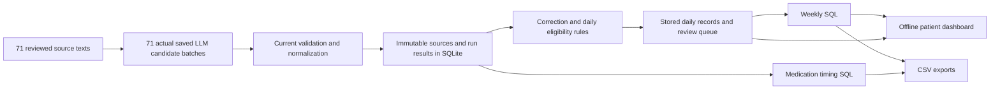

# Storage, counting, and chart decisions

The prototype now runs from source reports to normalized observations, SQLite,
derived daily records, two SQL queries, and an offline dashboard. The current
all-text demo replays 71 actual outputs from the frozen nausea-grouping prompt;
the older mixed-input demo retains its v1 cache. An offline rebuild makes no
additional model requests and needs no API key.

## Processing path

`src/demo.py` imports normalized results, reloads the stored run, computes its
analysis, and persists those derived records. Both query exports and chart data
come from SQLite. Gold fixtures are never read by this path. Free-text candidates
are actual saved model output. The current `longitudinal_text` dataset has empty
questionnaire arrays throughout. The original mixed-input dataset is still
supported separately, with direct form processing only for empty-text reports.
Uncached or changed free text fails explicitly instead of becoming an empty
successful extraction. A fresh text extraction remains available through
`run_pipeline.py extract` and an explicit new output path.

## Relational schema

The executable schema is `sql/schema.sql`. Sources and processing versions are
separate so a later extraction cannot silently rewrite a patient submission.

| Table | Role |
| --- | --- |
| `patients` | Fictional identity, timezone, inclusive follow-up start/end. |
| `reports` | Original text, questionnaire answers, submission timestamp, explicit replacement link, source hash. |
| `medication_changes` | Medication label, change type, original offset timestamp, UTC timestamp. |
| `runs`, `run_patients`, `run_medication_changes` | Explicit processing run and its input membership. |
| `report_results` | Status, raw model text, candidates, failure details, metadata, and full result envelope per run/report. |
| `observations` | Normalized fields, evidence, issues, and possible UTC time bounds. |
| `analyses`, `effective_reports`, `correction_decisions` | Derived analysis version and correction decisions without deleting originals. |
| `daily_summary`, `review_items` | Query-specific daily eligibility, coverage, source IDs, and unresolved reasons. |

Imports use transactions, foreign keys, strict source/prediction validation,
source hashes, and evidence checks. Reimporting the exact same run is a no-op.
Changed content under an existing source or run identifier is rejected; a new
extraction requires a new run ID. Existing observations remain attached to their
original run. Queries always name the run; there is no hidden latest-run switch.
An analysis may be recomputed, but only derived materializations are replaced.

## Which values enter a trend?

Each registered patient has one daily row for every follow-up day. Count and
severity eligibility are independent, with `usable`, `review`, or `missing`
status. A source diagnostic can coexist with a usable value from an independently
eligible source. For example, an invalid text scale does not invalidate a valid
questionnaire severity solely because both sources are retained.

| Input situation | Daily treatment |
| --- | --- |
| Explicit daily absence | A supported zero, not a missing day. |
| Compatible cumulative updates | Latest compatible value; never sum snapshots. |
| A later unknown/conflicting cumulative value | Review; do not silently fall back to the earlier known count. |
| Cumulative count decreases without a valid replacement | Review; count stays null. |
| Explicit completed-day total | Prefer it only when compatible with other totals and no larger prior count. |
| Event/window count with unresolved overlap | Preserve the observation and flag it; do not promote it to a daily total or add it to a cumulative count. |
| Unknown date or multi-day total | Preserve for review; no allocation to single days. |
| Hypothetical symptom | No observed count or severity contribution. |
| Failed extraction or missing submission | No zero imputation; failure remains reviewable. |
| Eligible 1-5 worst-so-far severity | Daily worst compatible value; contradictory/decreasing comparable summaries require review. |

The current conservative policy does not combine standalone events/windows into
a daily count, even when an individual episode is clearly reported. For example,
R003's exact episode is visible in source details and the medication timing query,
but is not treated as the complete daily frequency. This reduces coverage and is
shown explicitly. Future work could model proven non-overlapping event groups.

Earlier cumulative cutoff phrases are used only to order comparable snapshots.
They are not episode times. Supported HH:MM/noon cutoffs are interpreted in the
report timezone; unsupported earlier-cutoff wording stays in review rather than
silently acquiring the submission time.

## Corrections

Resolve replacement links before aggregating. Valid links must point to an
earlier report for the same patient. The replacement must preserve the original
symptom/date contexts and applicable fields. Incomplete, failed, or branching
replacements are rejected for aggregation; they must not deactivate the valid
original. Chains of complete replacements are supported. Content completeness
is conservatively checked; this is not a general natural-language edit detector.
Changing a symptom's date or removing a symptom context is outside this bounded
replacement contract and requires review rather than deactivating the original.

R006 replaces R005. The database still contains R005's vomiting count 3 and
nausea severity 4. The effective November 4 count is 2, matching R006 and the
earlier cumulative R004. The values 2, 3, and 2 are never summed into 7.

## Two useful SQL queries

**Weekly counts:** `sql/weekly_counts.sql` sums eligible daily reported values,
with counts of follow-up, reported, count-covered, review, missing, partial, and
completed-day days. SQL `SUM` stays null when no usable value exists. A week with
incomplete reporting is not presented as a complete frequency estimate. Weeks
start Monday; November 1-28 intersects five clipped calendar-week buckets.

**Medication timing:** `sql/after_medication_change.sql` compares effective,
present observations with recorded changes for that patient. Exact episode
times and date-only ranges are converted to possible UTC bounds before querying.
Rows are classified as `after`, `at_change_time`, `indeterminate`, or
`unknown_date`; definite-before rows are excluded. Same-day date-only reports are
indeterminate. DST repeated/skipped local times do not become invented precise
instants. Multiple changes can provide several contexts for one observation.
This is temporal association, not causation. `after_taking` text alone does not
prove order relative to a separate medication-change record.

This query is retained in the CLI and CSV export rather than the main dashboard.
The source data record starts, stops, and dose changes, not each actual dose
administration. Being after a recorded change therefore does not establish that
a symptom followed that day's medication intake.

## Presentation and limits

The self-contained HTML dashboard has patient selection, daily frequency and
nausea charts, weekly counts and coverage, a review queue, and expandable
original/corrected source records. Each chart has a medication legend identifying
the medication, change type, and date for its M1/M2 markers. These identify
changes, not distinct medicines or individual dose administrations. The separate
medication timing table and its category filter are omitted from the main page.
Zero is plotted explicitly; missing or ineligible values create gaps, not
connecting lines. Partial daily counts and completed-day totals use different
markers. Source strings are escaped and rendered as text, with no remote assets
or API requests.

Review explanations show the underlying conflicting values or evidence, the
affected field, and its treatment in the daily statistics. Relevant source
reports are linked for comparison. Source record labels separate revision status
from processing status: **Current record** identifies the selected report version,
while **Processing completed** reports successful processing. **Needs review** can
coexist with both; neither label guarantees that all fields are eligible.

The prototype has no authentication, clinician review/write-back workflow,
production migrations, or clinical validation. It is a local synthetic-data
demonstration. Passing structural/evidence checks cannot establish complete
semantic accuracy; known extraction limitations are documented in the prompt
comparison reports. Reviewed examples must not be reused as fresh independent
test evidence in later model tuning.
